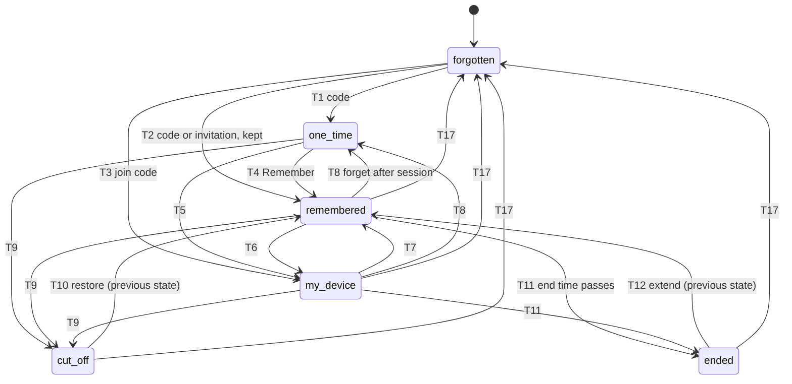

# tunlion: UX redesign from jobs (merged)

> Status: design, 14 Oct 2026. This is the merged design: the "UX redesign from
> jobs" proposal, the implementer review of it, the browser UI review, and a new
> job J11 (the dashboard). It replaces `docs/design-relationship-ux.md` where the
> two disagree. That document sends widenings over the network as offers for the
> other side to accept, and adds a yes/no prompt to serve shell; both conflict
> with the fixed constraints here.

## Summary

The proposal cuts the first browser shell on a VPS to 3 steps, with no permanent
relationship nobody asked for, and makes every later change to a relationship one
action, in place, on either device. It rests on five decisions.

1. **A code is an offer that says what it offers.** A code carries a shell, a
   port, a folder, files, or "join my devices", plus the most it may later grow
   into (its ceiling). The person who receives it never has to know which kind
   it is: there is one place to enter any code, `tunlion open <code>` in the CLI
   and one box in the browser.
2. **One record per relationship, read by every gate.** Each device keeps one
   record per other device: state, what each side may use, one end time, and the
   ceiling. Every entry point (shell, commands, ports, folders, files, mesh
   traffic, renewal) asks the same record, and an open session is cut the second
   the record says it ended.
3. **Asking travels; granting never does.** Either device can ask for more. Only
   the device whose resources are being opened writes the change, locally. It
   writes it at once when the ask is inside the ceiling its owner already
   approved, and otherwise it queues the ask for its owner.
4. **Narrowing is always allowed without asking.** Either side can remove access,
   shorten or add an end time, cut off, or forget, alone and at once. Widening
   needs consent only from the side whose own access grows.
5. **The browser is a full device, but not an owner (v1).** It gets its own
   device key, so it can be one-time, remembered, or one of your devices (as a
   member), and it can open a shell. It never holds the owner key in v1: owner
   actions (add a device, the recovery phrase) stay on CLI devices.

**Evidence and its limits.** The proposal read `cli/src`, `crates/` and
`frontend/src`, and ran the released 0.8.5 binary against the live server. Its
"today" step counts therefore describe 0.8.5, not the launch build:

- J1 was impossible on every 0.8.x: browser receive by code and browser pairing
  have been broken since July 2026 (fixed by PR #421).
- Already fixed in 0.9.0: the 45 to 60 s join hang (#418), expiry enforced at
  every entry point (#415), and `--for person` being ignored (#416).
- Every "today" count below is marked **to re-count on 0.9.0 plus #421** before
  it is quoted anywhere.

## Jobs

Eleven jobs, written from the user's side. J1 to J6 are the given starting set,
corrected; J7 to J10 are added because the first six depend on them; J11 is the
dashboard. The evaluator's "top jobs" are J1 to J6.

| # | Job, in the user's words | Holding | Has in hand |
|---|---|---|---|
| J1 | "I have only a browser and want a shell on my VPS, now." | Any browser: a borrowed laptop or a phone | One way to type a command on the VPS (the provider's web console, or someone already logged in). tunlion may not be installed there yet. |
| J2 | "I want to hand a friend a file without either of us installing anything." | A browser each | The file, and a way to tell the friend a short code (voice, chat) |
| J3 | "I want a contractor to reach one port on my server until Friday, then lose access by itself." | A terminal on the server | The port number and an end time. The contractor may or may not already use tunlion. |
| J4 | "I want all my machines to reach each other permanently, including a new one I just set up." | A terminal on one machine already set up, and one on the new machine | Nothing else. No account, no file to copy. |
| J5 | "I gave someone temporary access and now want to keep them, or cut them off early." | Either device: the one that granted, or the one that holds access | The other device's name |
| J6 | "An AI agent on my laptop should run a command on my server without asking me each time, within limits I set." | The laptop; the agent has a terminal | A list of commands the agent may run, and how long it may run them |
| J7 | "I already remembered my VPS from this browser; I want its shell again." | The same browser, days later | Nothing |
| J8 | "I want to drop a file onto one of my own machines from my phone." | Phone browser | The file |
| J9 | "I lost a laptop; it must lose access to everything now." | Any of my other devices | The lost device's name |
| J10 | "I want to see what can reach this machine, and until when." | Either a terminal or a browser on that machine | Nothing |
| J11 | "I want to manage all my devices, codes and access from one screen, easily, without making anything less safe." | An owner device (any desktop with tunlion) | Nothing |

Two corrections to the starting set. J1 always needs one command typed on the VPS
for the first visit, because only the VPS can consent to opening its own shell;
"only a browser" means only a browser on the user's side. J5 is two jobs on two
devices: keeping someone is widening (it adds time), cutting them off is
narrowing, and the rules differ.

## Relationships

Two devices have exactly one relationship, in one of six states, plus what each
side may use on the other and one shared end time. Both sides hold a copy of the
record; each side's copy is the only authority over its own resources.



Cut, restore, extend and end time act on whichever in-use state the relationship
was in, and return it there. One-time to my device (T5) and the end-time moves
inside a state (T13, T14) are in the transition table.

### The six states

| State (user-facing word) | Protocol term | What is stored | What it allows |
|---|---|---|---|
| one-time | one-time | Nothing on disk. A session key in memory, held for a 10-minute remember window after the session ends, then wiped. | The one thing the code offered, for one session or one transfer |
| remembered | pairwise | One record on each side: the other's device key, its name, access per direction, end time, ceiling | Each side reaches the other by name, with no code, within its access |
| my device | mesh | The remembered record plus an owner-signed certificate | Reaches, and is reachable from, every other device of the same owner, within each device's own mesh access |
| cut off | revoked | The full record, marked cut off, with who did it and when | Nothing. Reversible by the side that cut. |
| ended | expired | The full record, marked ended at its end time | Nothing. Renewable in place. |
| forgotten | none | Nothing | Nothing. The only way back is a new code. |

### Access words

Access is written per direction and always by the side being reached. The same
five words are used in the CLI, the browser and the JSON.

| Word | Means | Replaces today |
|---|---|---|
| files | send files to this device | `transfer` |
| shell | interactive shell, which includes commands | `shell` capability, `up --shell`, `--i-know` |
| commands | run commands without a terminal, optionally only from a list | rode on `shell` |
| port 8080 | reach one named port (or `ports` for all) | rode on `shell`; `expose` |
| folder ~/share | mount one folder, read-only unless `(write)` | `mount` |

### The plain line

Every surface shows the relationship as one line, built by one shared function
and therefore identical on both devices. It uses each device's own name (the name
its owner gave it), never a local alias, and absolute times in UTC.

```
remembered · phone can use web-vps for: shell · web-vps can use phone for: nothing · ends Fri 17 Oct 18:00 UTC
```

The local list may add a relative time after the line ("in 3 days"); the line
itself never differs. Two devices with the same name are shown with a 4-character
key suffix (`laptop·3f2a`).

### Rules of movement

1. **Narrowing needs no one's consent.** Removing access, adding or shortening an
   end time, cutting off, and forgetting take effect at once, from either side.
   The side being reached writes the narrowing locally; a narrowing asked for by
   the other side is applied without a prompt.
2. **Widening needs the consent of the side whose access grows.** Adding access,
   extending or removing an end time, and moving up a state (one-time to
   remembered, remembered to my device) need the consent of each device that
   will be reached more than before. A device whose own exposure does not grow
   is not asked.
3. **Consent can be given early, as a ceiling.** When a device issues a code or
   invitation, its owner states the most it may grow into. Any later ask at or
   under that ceiling is applied by the issuing device on its own, so the upgrade
   is one click on the asking side.
4. **Asks travel; grants never do.** An ask is a signed message saying "I would
   like X". It changes nothing on arrival. The receiving device either applies it
   under its ceiling, or queues it for its owner, who accepts on that device.
5. **Time is enforced everywhere.** One check, `allowed(record, access, now)`,
   runs at every entry point: shell, commands, port, folder, files, mesh traffic
   and certificate renewal. A timer fires at the earliest end time across open
   sessions and closes them.

### The ceiling

A ceiling is three things the issuing owner approved up front: the highest state
(one-time, remembered or my device), the most access, and the latest end time (or
none). Defaults, by what was shared:

| Shared | Default ceiling | Turn it off |
|---|---|---|
| a shell | remembered, shell, ends 30 days after it is kept (extendable in one action) | `--once` |
| a port | remembered, that port only, until the share's end | `--once` |
| a folder | remembered, that folder at the same write level | `--once` |
| files (send) | remembered, files both ways | `--once` |
| "join my devices" (`add`) | my device, with mesh access **files only**; shell is a separate switch, off by default | not offered |

The issuing screen always prints the ceiling in one line, so the default is
consent the owner saw: *If they choose Remember, they keep shell on this machine
until Thu 13 Nov 18:00 UTC (30 days, extendable). Use --once to stop that.*

Why a kept shell has a default end: the person who claims a shell code can
already do anything in that shell, including leaving a backdoor, so keeping the
same access adds little power. But a backdoor takes effort and leaves traces,
while a remembered shell with no end time turns a lost phone or a bad script on
the web app into a permanent shell. Thirty days, extendable in one action, keeps
the upgrade one click and bounds the damage.

Why mesh access starts at files: shell everywhere by default makes one
compromised laptop worth the whole mesh, and it reverses the "remote shell is
off" default that setup shows today. The add screen shows shell as one switch,
with the reason beside it.

## Transition table

Every state can reach every other state it makes sense to reach, in place, from
either device; only forgotten needs a new code to come back. **G** is the side
being reached (the granting side); **H** is the side that holds access.
"Ceiling" in the consent column means the move needs no prompt when it is inside
the ceiling G issued, and otherwise becomes a request G's owner accepts on G.

| # | From → to | Action (CLI · browser) | Who must consent | Where it can start | What each side sees after |
|---|---|---|---|---|---|
| T1 | forgotten → one-time | `tunlion share shell` then `tunlion open <code>` · Share, Enter a code | G by issuing, H by entering the code | Issue on G, claim on H, CLI or browser on either | `one-time · phone can use web-vps for: shell · ends when the session ends` |
| T2 | forgotten → remembered | `share` or `send` with `--keep`, or an invitation file, then `open` | G by issuing, H by claiming | Either | `remembered · …` with the access the code named |
| T3 | forgotten → my device | `tunlion add` then `tunlion open <code>` · Add a device, Enter a code | Owner device by issuing; new device by claiming a code that says "join alex's devices" | Issue on an owner CLI device; claim on CLI or browser (a browser joins as a member) | `my device · …` on both, and on every other device of the owner within seconds |
| T4 | one-time → remembered | `tunlion remember <device>` · Remember button on the session-end card | H by clicking; G by ceiling, else G's owner accepts | Either side, during the session or within 10 minutes after | Both: `remembered · …`, access unchanged |
| T5 | one-time → my device | `tunlion add <device>` · Make it one of my devices | The owner side by ceiling or prompt; the other device by clicking | Either, during the session or within 10 minutes | `my device` on both |
| T6 | remembered → my device | `tunlion add <device>` · Make it one of my devices | Owner side (ceiling or prompt) and the joining device (its own click, since it grants mesh access to itself) | Either | `my device`; the pairwise access is kept underneath |
| T7 | my device → remembered | `tunlion remember <device>` · Keep, but not as my device | Nobody (narrowing) | Either: the owner removes it, or the device leaves | `remembered`; mesh-derived access gone, explicit access kept |
| T8 | remembered or my device → one-time | `tunlion forget <device> --after-session` · Forget when I close this | Nobody | Either | Session continues; the record is gone on that side when it closes |
| T9 | any → cut off | `tunlion cut <device>` · Cut off | Nobody | Either | Cutter: `cut off by you`. Other: `cut off by web-vps at 14:02 UTC`. Open sessions close now. |
| T10 | cut off → state before | `tunlion restore <device>` · Restore | The side that cut (the other side never withdrew) | Only the side that cut | Both: the earlier line, plus a one-line notice on the other side |
| T11 | any with an end time → ended | none: the end time passes | Nobody | Automatic, on both | `ended Fri 17 Oct 18:00 UTC`. Sessions close at that second. |
| T12 | ended → state before, with a new end time | `tunlion until <device> <time>` · Extend | Each side whose access grows: ceiling or prompt | Either: G applies directly, H asks | The earlier line with the new end time |
| T13 | any → same state, end time added or brought earlier | `tunlion until <device> <time>` · Set end time (earlier) | Nobody | Either | Same line, new `ends …` |
| T14 | any → same state, end time removed or moved later | `tunlion until <device> never` · Keep | Each side whose access grows | Either: G applies, H asks | `… · no end time` |
| T15 | same state, access added | `tunlion allow <device> <access>` · Allow / Ask for | G: ceiling or prompt | On G it applies; on H it asks | Line shows the new access on both |
| T16 | same state, access removed | `tunlion deny <device> <access>` · Remove | Nobody | Either (H can drop what it holds) | Line shows the smaller access on both |
| T17 | any → forgotten | `tunlion forget <device>` · Forget | Nobody | Either; affects only that side's record | Forgetter: no row. Other side: `forgotten by phone`, nothing allowed, one action: forget it here too. |
| T18 | my device → cut off on every device | `tunlion cut <device>` on an owner device · Cut off everywhere | Nobody | Any owner device | Every device of the owner drops it from its mesh access within one roster refresh; open sessions close |

Three properties hold across the table. Every widening row (T1 to T6, T10, T12,
T14, T15) has a consent entry on each side whose access grows. Every narrowing row
has "Nobody". Forgetting (T17) is the only row with no way back in place, which is
deliberate: a forgotten device is a stranger. These properties are checked by
machine (see Phase 2), not by reading this table.

Two cases the table settles that today's code does not. A device that already has
its own identity can still join someone's devices (T3, T6): joining adds a
certificate and needs no clean identity. If the joining device already owns
devices of its own, it is asked once to give that up, since a device has one
owner. And a cut-off record keeps the access it had, so T10 restores exactly what
was there.

## Flows

The proposed flows cut the six top jobs to 14 steps in total, and four of them
stop ending in a dead end. A step is one command, one click, one code typed, or
one file copied; installing tunlion counts as one step and is shown separately
because it happens once per machine.

All "Today" figures were measured on 0.8.5 or read from source. **Re-count all of
them on 0.9.0 plus PR #421 before quoting them.**

| Job | Today (0.8.5) | Proposed | How today was measured | Dead end today (0.8.5) |
|---|---|---|---|---|
| J1 browser shell on VPS | impossible (browser pairing broken on 0.8.x); 9 steps once #421 lands | 3 | Source and browser UI; 0.8.5 `add` refused to run without a terminal | No one-time shell exists; the result is permanent |
| J2 file, browser to browser | 8 | 5 | Browser UI source | Two code boxes; picking the wrong one fails |
| J3 contractor, one port, until Friday | 6 | 2 | Run on 0.8.5 up to join | Port needs a shell grant; join refuses a device with an identity |
| J4 add a new machine to my devices | 5 | 2 | Run on 0.8.5 | join hung 45 to 60 s with no output (fixed in 0.9.0, #418) |
| J5 keep, or cut early | 4 / 1 | 1 / 1 | Source | Keeping means a new invitation and a rejoin |
| J6 agent runs commands within limits | 2 | 1 | Source | No command limit, no end time, `exec` refuses `--json` |
| J7 shell again from a remembered browser | 2 | 2 | Browser UI source | none |
| J8 file from phone to my desktop | 2 | 2 | Browser UI source | none |
| J9 lost laptop loses everything | 1 per device | 1 | Source | Certificate revoke is local to one device |
| J10 what can reach this machine | 1 | 1 | Run on 0.8.5 | Line ignores certificate expiry |

Totals for J1 to J6 count "keep" for J5 (4 today, 1 proposed). Install steps are
excluded from both columns.

### J1. Browser shell on my VPS, first time (3 steps)

VPS terminal, then any browser. Install first if needed (+1).

1. VPS: `tunlion share shell`. Prints a code, the site, and the ceiling line. No
   prompt: running it is the consent.
2. Browser: open tunlion.autumated.com.
3. Browser: type the code into **Enter a code**. The terminal opens straight
   away, as the user who ran step 1.

Upgrade: when the shell closes, the browser shows **Remember web-vps** with a
10-minute countdown. One click (T4) stores the record on both sides; the VPS
applies it under its ceiling (shell, 30 days) and keeps listening in the
background, which its share screen said it would. The CLI form of the same claim
is `tunlion open <code>`, 1 step.

Today (to re-count): VPS `tunlion add`; browser open site, choose "pair with
code", type code, name it and click remember; VPS confirm; VPS `tunlion grant
<browser name> shell`; VPS `tunlion up --detach`; browser click the shell chip.

### J2. File to a friend, both in browsers (5 steps)

1. Sender: open the site.
2. Sender: drop the file. With no one else in the room, a code appears at once;
   no "get a code" click.
3. Friend: open the site.
4. Friend: type the code. The transfer starts; the code was the consent, so there
   is no accept.
5. Friend: click Save (browsers block downloads that no click started).

Upgrade: both see **Remember each other**. If the friend clicks, the sender's
ceiling (files both ways) applies it at once. If the sender clicks, the friend
gets one accept. CLI to CLI is 2 steps: `tunlion send <file>`, `tunlion open
<code>`.

The reverse, "let someone send me files", is the same offer kind as `share files`
with a one-time ceiling (`share files --once`): in this model `share X` offers the
claimant use of X on the issuer, and "files" means "send files to this device".
`send <file>` (push specific files) stays the separate offer.

Today (to re-count): sender open, "get a code"; friend open, "pair with code",
type it; sender drops the file on the friend's tile; friend accepts; friend saves.

### J3. Contractor reaches port 8080 until Friday (2 steps)

1. Server: `tunlion share port 8080 --until fri`. Because the end time outlasts
   one session, this creates a remembered relationship on claim. `--file
   contractor.invite` writes an invitation file instead of a 10-minute code.
2. Contractor: `tunlion open <code>` (or `tunlion open contractor.invite`). Port
   8080 is now on the contractor's `localhost:8080`, whether or not they already
   use tunlion.

On later days the contractor runs `tunlion port web-vps 8080` (1). At Friday
18:00 UTC the listener closes on the contractor side with `ended` (exit 13), and
the server line reads `ended`.

Today (to re-count), 6 steps and a shell the contractor should not get: `add --for
person --allow shell --expires 4d --out f`; deliver the file; contractor installs
into a clean identity; `join f`; server `up --detach`; contractor `forward
web-vps:8080`.

### J4. A new machine joins my devices (2 steps)

1. Any owner device: `tunlion add`. The code screen says "joins alex's devices"
   and shows the mesh access the new device will give the others (default: files;
   shell is a switch, off, with the reason beside it).
2. New machine: `tunlion open <code>`. It becomes `my device` on both ends and on
   every other device of the owner within one roster refresh (under 10 s), and
   stays reachable in the background.

A browser joins the same way, as a member: open the site, type the code. It
never becomes an owner in v1. To make an existing remembered device yours
instead: `tunlion add <device>` (T6, 1 step plus one accept on that device).

The first time a device acts as an owner (its first `add`), it shows the recovery
phrase once and asks to save it ("Save to a file" or "I wrote it down") before the
code appears. Identity is otherwise created silently on first use, but the owner
key that the whole mesh hangs on must not exist without a backup.

Today (to re-count): `add --for device --out f`, copy the file, `up` on the owner,
`join --invite-file f`, and a clean identity on the new machine.

### J5. Keep the contractor, or cut them off early (1 step)

- Keep, on the server: `tunlion until contractor never`, or **Keep** in the
  browser (T14). Asked from the contractor's side, the same command becomes a
  request the server's owner accepts.
- Cut off early, on either side: `tunlion cut contractor`, or **Cut off** (T9).
  Open sessions close at once; `tunlion restore contractor` undoes it.

Today: keeping needs a fresh invitation and a rejoin (4 steps); cutting is
`devices revoke contractor -y` (1).

### J6. An agent runs commands on the server (1 human step)

1. Server owner: `tunlion allow laptop commands "systemctl status *" "journalctl
   -u *" --until 30d`.

The agent then runs `tunlion run web-vps --json -- systemctl status nginx` with no
prompt. A command outside the list is refused with `not_allowed` and the exact
`allow` line the owner would run. The agent cannot widen its own limits: from the
laptop, `allow` only sends a request.

Today: 2 steps (`grant laptop shell`, `up --detach`) give a full shell with no
list and no end time, and `exec` does not take `--json`.

### J7 to J10 (unchanged counts, fixed behaviour)

- J7: open the site, click **Shell** on web-vps. Works only if the VPS runs in the
  background, which T4 now guarantees.
- J8: open the site, drop the file on my-desktop's row.
- J9: `tunlion cut old-laptop` on any owner device cuts it on every device (T18).
- J10: `tunlion devices`, or the browser home list, shows the plain line per
  device, with end times that are actually checked.

### J11. Manage everything from one screen (1 step to open)

1. Owner device: `tunlion dashboard`. A browser tab opens, already
   authenticated, on the fleet view.

Everything else in J11 is one click from there. See [Dashboard](#dashboard).

## CLI

The CLI has 29 verbs, each named for the job or the state it moves to, and drops
`init`, `receive`, `join`, `grant`, `revoke`, `exec`, `forward`, `mount`,
`expose` and the `devices` subcommands. Identity is created silently on first
use; nothing needs `init`. The recovery phrase is shown on the first owner action
(J4).

### Verbs

| Group | Verb | Does | Replaces |
|---|---|---|---|
| Share | `send <file>... [--to <device>]` | Send files; no `--to` prints a code | `send`, `send --code` |
| Share | `share shell` · `share commands [<pattern>...]` · `share port <n>` · `share folder <path> [--write]` · `share files [--once]` | Print a code (or `--file <path>`: an invitation file) that offers exactly that | `serve` (designed), `add --for` |
| Share | `open <code or file>` | Claim any code or invitation file and do what it offers. `tunlion <code>` is the same. | `receive <code>`, `join`, `add <code>` |
| Share | `add [<device>]` | No device: a code that joins your devices. With a device: make it one of yours, in place. | `add --for device`, `certify` (designed) |
| Use | `shell <device>` | Interactive shell | `shell` |
| Use | `run <device> -- <cmd>...` | Run one command | `exec` |
| Use | `port <device> <port> [--local <n>]` | That port on this machine's localhost | `forward`, `expose` |
| Use | `folder <device> <path> [<local>]` | Mount the folder | `mount` |
| Relationship | `devices [<device>]` | The plain line per device; one device shows detail and history | `devices`, `devices --caps`, `id` |
| Relationship | `remember <device>` | Up to remembered, or down from my device | `--remember`, `devices vouch` |
| Relationship | `allow <device> <access>...` | Add access; asks if run on the side that holds it | `grant`, `up --shell`, `requests approve --for` |
| Relationship | `deny <device> <access>...` | Remove access | `revoke <device> <cap>` |
| Relationship | `until <device> <when or never>` | Set, move or remove the end time | `--expires` (only at invite time today) |
| Relationship | `cut <device>` · `restore <device>` | Cut off now; undo | `devices revoke`, `devices restore` |
| Relationship | `forget <device> [--after-session]` | Delete this side's record | `devices forget` |
| Relationship | `requests` · `accept <id>` · `decline <id>` | Asks waiting on you, and yours waiting on them | `requests list/approve/deny` |
| Machine | `up` · `down` · `status` | Background service on, off, and what it is doing (names any process started by Remember) | same; `up` now detaches by default |
| Machine | `dashboard` | Open the owner dashboard in a browser on this machine (J11) | new |
| Machine | `name <new>` · `backup --file <path>` · `recover --file <path>` | This device's name; recovery phrase out and in | `init --name`, `id recover` |
| Machine | `reach <device>` · `doctor [<device>]` | Diagnostics | same |
| Agents | `skill install` | Unchanged | same |

Times for `--until` and `until`: `2h`, `3d`, `fri` (18:00 local, shown in UTC), or
an ISO date.

`tunlion <arg>` shorthand: an argument that is an existing path means send it;
anything else is treated as a code.

### Sample output

J1 on the VPS:

```
$ tunlion share shell
    code        amber-otter-4417
    open it     tunlion.autumated.com   or   tunlion open amber-otter-4417
    offers      a shell on web-vps, as alex, for one person, once
    if kept     they keep shell on web-vps until Thu 13 Nov 18:00 UTC (30 days, extendable); --once stops this
    expires     unused in 10 minutes

    waiting... (Ctrl-C cancels the code)
    phone (browser) opened a shell · direct · 14:02 UTC
    one-time · phone can use web-vps for: shell · ends when the session ends
```

J1 when the browser clicks Remember, still on the VPS:

```
    phone (browser) asked to be remembered; inside what you allowed, so done.
    remembered · phone can use web-vps for: shell · web-vps can use phone for: nothing · ends Thu 13 Nov 18:00 UTC
    tunlion now runs in the background so phone can come back (tunlion down stops it).
```

A claim from the CLI side (J3, contractor):

```
$ tunlion open teal-heron-2208
    web-vps offers port 8080 until Fri 17 Oct 18:00 UTC.
    port 8080 on web-vps is now localhost:8080 here.
    remembered · contractor-mbp can use web-vps for: port 8080 · web-vps can use contractor-mbp for: nothing · ends Fri 17 Oct 18:00 UTC
    later: tunlion port web-vps 8080
```

An ask outside the ceiling, seen on the side that must decide:

```
$ tunlion requests
    waiting on you
      r4  contractor-mbp asks for: shell on web-vps          2 min ago
          tunlion accept r4     tunlion decline r4
    waiting on them
      nothing
```

The device list (J10):

```
$ tunlion devices
  my-desktop      my device · my-desktop can use web-vps for: files · web-vps can use my-desktop for: files · no end time
  phone           remembered · phone can use web-vps for: shell · web-vps can use phone for: nothing · ends Thu 13 Nov 18:00 UTC
  contractor-mbp  ended · was: port 8080 · ended Fri 17 Oct 18:00 UTC
                  extend: tunlion until contractor-mbp 7d
```

Every failure is two lines: what happened, then the one next action.

```
$ tunlion shell web-vps
    web-vps cut you off at 09:12 UTC. Only web-vps can undo that.
    next: ask its owner to run   tunlion restore contractor-mbp
```

### Rules for every command

- No prompts on narrowing. One prompt, default No, on accepting a request that
  widens this machine; `--yes` answers it; with no terminal and no `--yes` it
  exits 15 (`needs_consent`) and prints the accept line.
- Codes, invitation files and recovery phrases are read from a path or pasted
  text, never taken as an argument other than the code itself. A code is not
  invitation material: it is a short password that only works with a live PAKE
  exchange and burns on first use, so it may be typed.
- `--json` works on every verb. Human text goes to stderr, data to stdout.
- Peer ids, fingerprints and route internals never appear unless `-v` is given.

## Browser

The browser has one home screen with three things on it (Enter a code, Send
files, My devices) and one device page; everything else is a card on top of
those. It uses the CLI's nouns exactly: code, device, remember, my devices,
shell, files, port, folder, cut off, forget, ends, accept, decline.

The browser gets a device key (WebCrypto Ed25519, non-extractable, in IndexedDB),
named from the platform on first use (`iphone-safari`; Rename on the device page).
In a private window it says once, at the top: "This window can't remember
devices. Codes still work." The browser can be one-time, remembered or a member
of your devices; it never holds the owner key in v1.

A shareable code link carries the code in the URL fragment
(`tunlion.autumated.com/#amber-otter-4417`), so it never reaches server logs or
referrers.

### B1. Home, first visit

```
+-----------------------------------------------------------+
| tunlion                                                   |
|                                                           |
|   Enter a code   [ amber-otter-4417          ] [ Go ]     |
|                                                           |
|   +---------------------------------------------------+   |
|   | Drop files here to send them   (or tap to pick)   |   |
|   +---------------------------------------------------+   |
|                                                           |
|   Let someone send me files              [ Get a code ]   |
+-----------------------------------------------------------+
```

One code box for every kind of code. What the code offers decides what happens
next: a shell opens B3, files show a Save row, "join alex's devices" shows the new
line on B2. Dropping a file with nobody else present shows the code at once (J2
step 2). The code box has a visible label and a visible focus state; the drop zone
is a real button reachable by keyboard.

### B2. Home, with devices

```
|   My devices and people                                   |
|   web-vps            online · direct                      |
|      remembered · iphone-safari can use web-vps for:      |
|      shell · web-vps can use iphone-safari for: nothing · |
|      ends Thu 13 Nov 18:00 UTC                            |
|      [ Shell ]                                  [ ... ]   |
|   my-desktop         online · relay                       |
|      my device · ...                                      |
|      [ Send files ]                             [ ... ]   |
|   contractor-mbp     ended Fri 17 Oct 18:00 UTC           |
|      [ Extend ]  [ Forget ]                               |
```

Buttons appear only for access this browser actually has (no Send files on
web-vps above, because files is not in its access). A row's whole surface is a
drop target for files where files is allowed (J8). Rows are focusable links.

### B3. Shell

```
+-----------------------------------------------------------+
| web-vps · shell · direct       one-time · ends with session|
|-----------------------------------------------------------|
| alex@web-vps:~$                                           |
|                                                           |
|-----------------------------------------------------------|
| Esc Tab Ctrl Alt   Up Down Left Right   | / ~ -   [Close] |
+-----------------------------------------------------------+
```

The header carries the short form of the plain line; tap to expand it. When the
end time is under 5 minutes away it shows a countdown; at zero the terminal prints
"Ended at 18:00 UTC by the end time web-vps set." and stops.

On phones the shell is full-bleed: the bottom navigation and hints are hidden,
the line collapses to its short form, and the key bar docks above the soft
keyboard. Key bar keys are at least 44 px. Build on
`frontend/src/ui/WebTerminal.jsx` (key map, sticky Ctrl/Alt, haptics, keyboard
avoidance) and fix its known issues: full-screen terminal apps, the hang on
keyboard show/hide, copy and paste.

When the link drops, the session is kept: the terminal dims, shows "reconnecting",
and resumes on the new link with its state intact (see session resume, Phase 1).

### B4. Session end: the upgrade card

```
+-----------------------------------------------------------+
| Shell on web-vps closed.                                  |
|                                                           |
| [ Remember web-vps ]                       9:58 left      |
| You would keep: shell on web-vps until Thu 13 Nov         |
| 18:00 UTC. web-vps gets nothing on this browser.          |
+-----------------------------------------------------------+
```

The browser never offers "Make it one of my devices" in v1: making another device
yours needs an owner device, so that stays `tunlion add <device>` on a computer
(T5, T6).

If the click is inside the ceiling, the card turns into the B2 row. If not, it
says "Asked web-vps. Its owner accepts there: tunlion requests." and the row shows
`waiting on web-vps`.

### B5. Device page

```
+-----------------------------------------------------------+
| web-vps                                                   |
| remembered · iphone-safari can use web-vps for: shell ·   |
| web-vps can use iphone-safari for: nothing ·              |
| ends Thu 13 Nov 18:00 UTC                                 |
|                                                           |
| This browser can use web-vps for                          |
|    shell    yes   [ Remove ]                              |
|    files    no    [ Ask for ]                             |
| web-vps can use this browser for                          |
|    files    no    [ Allow ]                               |
|                                                           |
| Ends    Thu 13 Nov 18:00 UTC      [ Set end time ]        |
| [ Cut off ]   [ Forget ]                                  |
+-----------------------------------------------------------+
```

- "Ask for" sends an ask (T15 from H); "Allow" writes locally, because this
  browser is the side being reached.
- **Set end time** follows the consent rules: an earlier time applies at once
  (T13); a later time or "never" widens this browser's access to web-vps, so it
  sends an ask and the row shows "Asked" (T14). There is no "Now" choice; ending
  access now is Cut off.
- When this browser is a member of alex's devices, its page for that membership
  offers **Leave alex's devices** (T7, narrowing, no consent). Mesh-derived access
  goes; explicitly remembered access stays.
- **Cut off** and **Forget** are one click each. Cut off shows "web-vps cut off.
  Undo restores access." for 10 seconds, then Restore. Undo brings back access,
  not a session that was closed. While a session with that device is open in this
  browser, Cut off asks once inline: "Cut off web-vps and close your shell?"

### B6. Asks waiting

A bar above B2, only when something waits on this browser:

```
|   web-vps asks: may it send files to this browser?     [ Accept ] [ Decline ]   |
```

The same words (Accept / Decline) are used here, on the Requests screen, and in
the CLI.

### B7. Failures

Same two-part shape as the CLI, in the place the action was tried:

| Situation | Text | One button |
|---|---|---|
| Code already used | That code was already used. Codes work once. | Enter another code |
| Code expired | That code expired. Ask for a new one. | Enter another code |
| Wrong words | That code didn't match. Check the words and try again. | Try again |
| Device offline | web-vps isn't reachable. It may be off, or tunlion isn't running there. | Try again |
| Ended | Your access to web-vps ended Fri 17 Oct 18:00 UTC. | Ask for more time |
| Cut off | web-vps cut this browser off at 09:12 UTC. Only web-vps can undo that. | Forget it |
| Not allowed | This browser can't use web-vps for files. | Ask for files |

### Accessibility

Every interactive element is a real button or link and reachable by Tab; inputs
have visible labels and focus states; switches have accessible names; text and
small controls meet 4.5:1 contrast in both themes; phone tap targets are at least
44 px. Pulse and knock animations stop under `prefers-reduced-motion`.

## Dashboard

J11 needs one screen for codes, invitations, members and "what can reach what".
It must offer a deep level of ease without compromising security. The rule that
sets everything else: **the dashboard is a convenient screen for an owner device,
not a control plane.** Authority stays on devices: the owner key signs
membership, each device writes its own access, and a grant never arrives over the
network. That is what contains a stolen owner key or a compromised server, and
the dashboard must not bring a central authority back.

### What it does

- **Codes and invitations.** Create a code or invitation with its ceiling and end
  time; see which are still open; cancel them. Enrolment keys for CI and borrowed
  machines live here too.
- **Membership.** Approve joins, make a device one of yours, remove a member, and
  cut off a lost laptop on every device in one click (T18, an owner-signed roster
  update).
- **Fleet view.** Every device's plain line, online state, open sessions and
  upcoming end times.
- **Asks.** One queue for everything waiting on you, accepted or declined in
  place.
- **History.** Who connected to what and when, gathered from each device's own
  log.
- **Exposure.** Which devices hold the owner key (ideally one, or few); which
  devices can reach a shell on which, with end times; which codes and enrolment
  keys are still open.

### Ease, made concrete

- **Zero setup.** `tunlion dashboard` opens an already-authenticated page. No
  login, no account, no password.
- **One click, consequence stated.** Every action is one click, and the
  confirmation shows the plain line as it will read afterwards, so the user sees
  the exact result before and after.
- **Templates for common arrangements.** Contractor port until Friday, CI runner,
  family phone, lend a GPU box. Each fills the offer, access, end time and ceiling,
  and shows them before the code is made.
- **QR for adding a phone.** Add a device shows a QR the phone camera opens
  straight into the code box.
- **Search and bulk select.** Find devices by name, state or access; select
  several and cut them off, shorten their end times or forget them in one action.
- **Undo for narrowing.** Every narrowing (cut off, remove access, shorten,
  forget) has Undo for 10 seconds, then the matching Restore.
- **One queue, with notifications.** Asks from every device land in one list with
  Accept / Decline; a desktop notification says when something new waits.
- **Review exposure.** A guided pass that walks the exposure view: shells with no
  end time, enrolment keys still open, devices not seen in 30 days, owner-key
  holders. Each item has one fix button.

### Security rules

1. **The dashboard never grants.** It narrows anything at once (cut off, shorten,
   remove, forget). It widens only by sending an ask, which the device being
   reached applies under its own ceiling or queues for its owner. Every action
   reports which happened: **applied** or **asked**.
2. **Where it runs decides how safe it is.**
   - Owner device (the design): `tunlion dashboard` serves the page from the
     owner device, so the owner key never leaves it. It binds to loopback only,
     on a random port, with a one-time secret in the URL fragment; it checks the
     Host and Origin headers on every request (so no other website and no
     DNS-rebinding trick can drive it); only the owner's own OS user can reach it.
   - The hosted site (tunlion.autumated.com) shows the same screens in
     **see-and-ask** mode only: it can display state and send asks, never perform
     owner actions.
   - Later: hosted owner actions backed by a passkey, so every owner signature
     needs a touch or fingerprint. A script could still trigger the prompt, so
     this is safer, not safe; it ships only after the web security work.
3. **No accounts, so nothing to phish.** Being the owner means holding the owner
   key; recovery is the recovery phrase. No email login, no password reset.
4. **No fleet database on the server.** The dashboard gathers state from devices
   over their end-to-end encrypted links. The server keeps only what it needs to
   introduce two devices, so there is no central list of everyone's devices,
   addresses and relationships to steal or subpoena.
5. **Enrolment keys are bearer secrets.** Defaults: single use, expiring, limited
   to a ceiling, shown once, stored only as a hash, listed, and revocable.
6. **Shell leaves traces the dashboard must show.** A device with shell can add
   SSH keys that outlive its access. History flags shell sessions, and cutting a
   device off lists the SSH keys added to `authorized_keys` during its sessions,
   with a one-click removal on that machine.
7. **Exposure is always visible.** The exposure view is one click from the top of
   every dashboard page.

### Shape

One design and one set of words with the browser app: the dashboard is the same
UI as the browser (B2, B5, B6), with owner panels (codes, membership, templates,
exposure) that exist only when served by an owner device.

## Agent surface

Every verb takes `--json`, writes exactly one envelope to stdout (or one NDJSON
line per event for verbs that wait), and exits with a code that maps one-to-one to
`error.code`. The browser uses the same relationship object internally, so the
three surfaces cannot drift.

### Envelope

```json
{"ok": true, "v": 1, "verb": "devices", "data": {}}
```

```json
{"ok": false, "v": 1, "verb": "shell",
 "error": {"code": "ended", "exit": 13,
           "message": "Your access to web-vps ended Fri 17 Oct 18:00 UTC.",
           "next": {"says": "Ask for more time", "run": "tunlion until web-vps 7d", "on": "this device"}}}
```

`next.on` is `this device` or the other device's name, so an agent knows when the
fix is out of its reach and must be handed to a person.

### The relationship object

Returned by `devices`, by every verb that changes a relationship, and in `open`
results.

```json
{
  "device": {"name": "web-vps", "key": "ed25519:3f2a9c..."},
  "state": "remembered",
  "line": "remembered · laptop can use web-vps for: commands · web-vps can use laptop for: nothing · ends Thu 13 Nov 09:00 UTC",
  "they_can_use_me": [],
  "i_can_use_them": [{"access": "commands", "only": ["systemctl status *", "journalctl -u *"]}],
  "ends": "2026-11-13T09:00:00Z",
  "ceiling": null,
  "cut_off_by": null,
  "waiting": []
}
```

`state` is one of `one-time`, `remembered`, `my-device`, `cut-off`, `ended`,
`forgotten-by-them`. `ceiling` is present only on the side that issued it.
`waiting` lists asks in either direction with `id`, `from` and `access`.

### Waiting verbs

`share` and `send` without `--to` print NDJSON events, so an agent can read the
code and hand it on:

```json
{"event": "code", "code": "amber-otter-4417", "offers": [{"access": "shell"}], "if_kept": {"state": "remembered", "access": [{"access": "shell"}], "ends": "2026-11-13T18:00:00Z"}, "expires": "2026-10-14T14:12:00Z"}
{"event": "claimed", "by": {"name": "iphone-safari", "key": "ed25519:9c41..."}, "route": "direct"}
{"event": "done", "relationship": {}}
```

### run

`run` passes the remote command's exit status through. When tunlion itself fails,
`run` exits 255, as ssh does, and the JSON says which kind:

```json
{"ok": true, "v": 1, "verb": "run", "data": {"exit": 3, "stdout_bytes": 120, "stderr_bytes": 0}}
{"ok": false, "v": 1, "verb": "run", "error": {"code": "not_allowed", "exit": 4, "message": "web-vps doesn't allow laptop to run 'rm'.", "next": {"says": "Ask the owner to allow it", "run": "tunlion allow laptop commands \"rm *\"", "on": "web-vps"}}}
```

In the second case the process exit is 255 and `error.exit` is 4. This removes
today's collision where a remote exit of 3 looked like "unknown device".

### Exit codes and error codes

| Exit | error.code | Happened | Next action |
|---|---|---|---|
| 0 | | done | |
| 1 | `error` | anything not below | report the message |
| 2 | `usage` | bad arguments | fix the command |
| 3 | `unknown_device` | no device by that name here | `tunlion devices --json` |
| 4 | `not_allowed` | the other side doesn't allow this access | the allow line, on the other device |
| 5 | `still_relayed` | `reach --until-direct` timed out on a relay | none; it works |
| 6 | `unreachable` | the device is offline or not running tunlion | retry, or start tunlion there |
| 7 | `network` | can't reach the tunlion server | check this machine's internet |
| 8 | `partial` | some files moved, some did not | run it again |
| 11 | `not_running` | no background service on this machine | `tunlion up` |
| 12 | `local_resource` | disk, memory or files ran out here | free space |
| 13 | `ended` | the end time passed | `tunlion until <device> <time>` |
| 14 | `cut_off` | the other side cut this device off | only they can restore |
| 15 | `needs_consent` | an ask was sent and waits on the other side, or this machine needs `--yes` | `tunlion requests` on the side named in `next.on` |
| 16 | `code_used`, `code_expired`, `code_wrong` | the code can't be claimed | ask for a new code |
| 17 | `forgotten_by_them` | the other side forgot this device | `tunlion forget <device>` |
| 255 | (in JSON) | `run` only: tunlion failed, not the command | read `error.exit` |

Exit 9 (`no_identity`) and 10 (daemon settings differ) go away: identity is
created on first use, and `up` applies new settings by restarting itself. Codes
are never renumbered once shipped; new failures get new numbers.

### Skill

`SKILL.md` is regenerated from this table and the verb table at build time, so
the skill, `--help` and the JSON cannot disagree. It tells the agent three things:
decide by `error.code`; never run `allow`, `until` or `accept` unless the user
asked for that exact change; and hand `next` to the user when `next.on` is another
device.

## Gaps and build order

Each PR ends with a gate in `cli/tests/gates.sh` (or the browser test suite) that
runs its job and asserts the step count, so the evaluator's count is checked on
every build. Sizes: S is under 300 changed lines, M is 300 to 1,000, L would
exceed 1,000 and is already split.

### What the code does today, against the design

| Design element | Today | Gap |
|---|---|---|
| A code says what it offers | Scope byte bound into the PAKE confirmation, always `IntroScope::Device` (`pair_cmd.rs`, `send_cmd.rs`) | Widen the byte to an offer: kind, access, end, ceiling |
| One-time shell | None. A code session is never trusted, so `pty-open` is refused | New: serve a PTY to one PAKE session |
| One code box | Browser has "pair" and "receive" modes; CLI has `receive`, `join`, `add <code>` | Merge into `open` and one box |
| Remember after a session | Send side discards the secret; `--remember` stores nothing (observed on 0.8.5) | One ask, applied under the ceiling |
| Browser device key | Pair secrets in localStorage only (`lib/devices.js`) | Key in IndexedDB; records keyed by device key |
| One record, one gate | Pair secret, cert, capability store, ceiling fields, `ShellPolicy`, shadow and authoritative modes, all combined per call (`shell_gate.rs`, `capability.rs`) | Replace with one record and `allowed(record, access, now)` |
| End time at every entry point | Enforced for invitation-admitted devices (`DelegatedAccess`, sweeps in `recv_cmd.rs`, #415); `grant` has no end time | Every grant carries one; one timer cuts sessions |
| Port access alone | Forwarding rides a shell grant (`TUNNEL_OFF_REASON`) | `port <n>` as its own access |
| In-place upgrade | A grant cannot widen a ceiling; the fix is a new invitation (`CEILING_REASON`) | Asks, applied by G under its ceiling or queued |
| Join with an existing identity | Refused (`enrollment.rs:58`) | Join adds a certificate; one owner per device |
| Commands with limits | `exec` rides shell; no `--json` | `commands` access with a list; `run --json` |
| Distinct failures | `denied` covers ended, cut off, not allowed; `exec` exit 3 collides | Exits 13 to 17; `run` 255 |
| Sessions survive a dropped link | A session is bound to the link it started on; a drop ends it | Session id that outlives the link; reattach on a new link |
| CLI to browser compatibility | No CI test runs a CLI handshake against the browser (four drifts went unnoticed until #421) | CI job: CLI and browser complete a code handshake |
| Web app security | Auto-deploy on push to main; third-party scripts possible | Strict CSP, pinned dependencies, reviewed deploy, own origin |
| Dashboard | None | J11, after Phase 2 |

### Build order

**Phase 0: launch.** Ship 0.9.0 with PR #421 (browser receive, pair and shell
fixed against the 0.9.0 CLI).

**Phase 1: browser one-time shell (J1)**

1. **Web app security.** Strict content security policy with no third-party
   scripts, pinned and reviewed dependencies, a reviewed deploy instead of
   auto-deploy on push, ideally its own origin. Lands before anything that puts a
   shell-capable key in the browser. M.
2. **CLI to browser handshake test in CI.** Build or download the CLI, start the
   local backend, drive the built frontend in Chromium through receive and pair.
   S to M.
3. **Offer in the code.** Replace the scope byte with an offer record (kind,
   access, until, ceiling) in `crates/filament-pair` and the wasm build; MAC it in
   the confirmation so a shell code can't be spent on a folder. M.
4. **`tunlion share shell`.** Mint, accept one claim, serve the PTY from the
   foreground process as the invoking user, gate on the session alone. Reuses the
   `pty-open` acceptor in `l2.rs`. M.
5. **One code box in the browser.** Claim, read the offer, route to the terminal,
   Save, or join. Generalises `receiveWithCode` in `useTunlion.js`; deletes the
   pair/receive split in `Tunlion.jsx`. M.
6. **Session end time.** `--until` on `share`, a timer that closes the session,
   the B3 countdown. S.
7. **Session resume.** Sessions (shell, port) carry an id that outlives the link
   and reattach on a new link with their state; the B3 reconnect state. Also the
   foundation for the link manager (reuse warm links, open new ones, switch over).
   M to L, split.
8. **Remember after a session.** Keep the session key 10 minutes; the ask frame;
   G applies under its ceiling (shell: 30 days) and moves itself to the
   background; browser B4 card. Fixes the `--remember` defect. M.
9. **Browser device key.** WebCrypto Ed25519 in IndexedDB; records keyed by key;
   private-window notice. Member-level only, never owner. M.

**Phase 2: one record, one gate**

10. **Record schema.** `devices.json` v3: state, access per direction, ends,
    ceiling, cut off by. Old stores are wiped, not migrated. M.
11. **One gate, as a pure evaluator.** `allowed(record, access, now)` at shell,
    run, port, folder, files, mesh traffic and renewal; one timer cuts open
    sessions at the earliest end. Lands as the pure capability-ledger evaluator
    already agreed, checked by a model checker or property tests (like the
    establishment model in CI). Machine-checked properties: every widening has
    consent on each growing side; every narrowing needs none; a grant can never
    arrive over the network. M.
12. **Delete the old decision paths.** Shadow and authoritative modes,
    `ShellPolicy::All`, `up --shell`, `--i-know`, petnames, `principalKind`. M.
13. **Plain line renderer.** One Rust function, compiled to wasm for the browser.
    S.
14. **Errors.** Envelope `v:1`, exits 13 to 17, `run` 255, `--json` on every
    verb. M.

**Phase 3: contractor, keep or cut, agent (J3, J5, J6)**

15. **Port access on its own.** `share port`, `tunlion port`; removes the shell
    dependency and `expose`. M.
16. **Asks and requests both ways.** Ask frame handling on G (apply under
    ceiling, else queue), `requests`, `accept`, `decline`. M.
17. **Relationship verbs.** `allow`, `deny`, `until`, `cut`, `restore`,
    `forget`, `remember`. M.
18. **Browser device page and asks bar** (B5, B6), with the consent-correct Ends
    control and the session-aware Cut off confirm. M.
19. **`commands` with a list.** Pattern matcher, `run`, refusal names the allow
    line. M.
20. **Invitation files.** `share --file`, `open <file>`. S.

**Phase 3b: dashboard (J11)**

21. **`tunlion dashboard` server.** Loopback, random port, one-time fragment
    secret, Host and Origin checks, owner-only; serves the browser UI with owner
    panels. M.
22. **Fleet view, asks queue, history.** Gathered from devices over E2E links; no
    server-side store. M.
23. **Codes, templates, enrolment keys.** Single-use, expiring, ceiling-scoped,
    shown once, stored hashed, listed, revocable; the four templates; QR for
    phones. M.
24. **Exposure view and review pass.** Owner-key holders, shell reach with end
    times, open codes and keys, stale devices, SSH keys added during shell
    sessions; bulk select and Undo. M.
25. **Hosted see-and-ask mode.** The same screens on tunlion.autumated.com
    without owner panels. S.

**Phase 4: my devices (J4, J9)**

26. **Join without a clean identity.** `add` code, `add <device>` in place, the
    one-owner question, recovery phrase on first owner action. M.
27. **Mesh access from the roster.** Each device maps roster membership to its own
    mesh access (default files only); `cut` on an owner device tombstones the
    member everywhere. M.
28. **Browser as one of my devices (member).** Certificate on the browser key;
    appears in the roster; can open shells to members it has access to. Never an
    owner. M.

**Phase 5: cleanup**

29. **Remove what was replaced** (`init`, `receive`, `join`, `grant`, `revoke`,
    `exec`, `forward`, `mount`, `expose`, `devices` subcommands, `requests
    approve --for`); generate `--help`, `SKILL.md` and the README command list
    from the verb and error tables. M.

**Later:** passkey-backed owner key for hosted owner actions (after Phase 1 #1 has
held up in practice).

The silent join hang seen on 0.8.5 is fixed in 0.9.0 (#418); keep the rule that
every waiting verb prints a progress line within 2 s.

## Open questions and risks

Six decisions are still open; each is stated with the default this design
assumes, so building can start without them.

1. **A standing door for J1.** A browser with no relationship always needs one
   command typed on the VPS. The alternative is a long-lived reusable secret the
   VPS accepts at any time, which weakens "consent on both ends" to "whoever holds
   the secret". Default: no standing door. Recovering from a lost browser goes
   through any other remembered device or the provider console.
2. **Default ceiling for a shell code.** Decided: keepable, with a 30-day default
   end, extendable in one action; the share screen says so. `--once` turns keeping
   off.
3. **The background service after Remember.** J1 moves the share process into the
   background so the browser can come back (a detached process, not a boot
   service). This is pre-consented on the share screen, but it is still a process
   the owner did not start by name. Default: detach, print how to stop it, and
   name it plainly in `tunlion status`; `up --install` remains the explicit way to
   survive a reboot.
4. **Clocks.** End times are signed and shown in UTC. Two machines with skewed
   clocks disagree about when "ended" happened. Default: each side enforces its
   own clock on its own resources, and the plain line shows the granting side's
   end time.
5. **Browser storage loss.** Clearing site data deletes the browser's key, which
   turns every remembered device into "forgotten by them" on the other side.
   Default: show it that way, with Forget as the one action; no key export from
   the browser in v1.
6. **Ports in a browser.** J3 for a contractor who has only a browser would need an
   HTTP proxy through a service worker. Default: out of scope for this design; the
   contractor installs the CLI.

One risk for the evaluation itself: the "today" counts come from 0.8.5 and, for J1
and J2, from source rather than a run. They are re-counted on 0.9.0 plus #421 on
real machines before any number is quoted.
