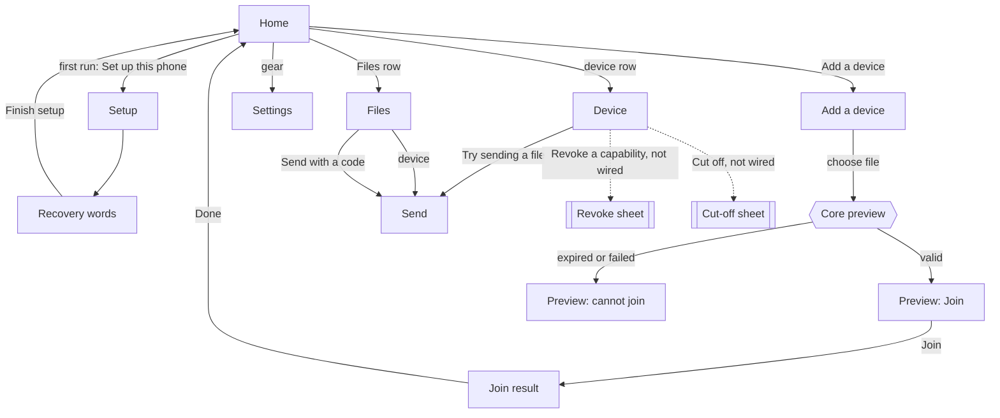

# Tunlion Android redesign: design proposal

Status: proposal for review. No app code changes accompany this document.
Base: `feat/android-fleet-client` at `c2b9b6ad3`.
Companion: [`mockups.html`](mockups.html) holds annotated phone-frame mockups.
Each mockup annotation names the section of this document it implements.

Contents

1. Purpose and principles
2. What changes from the current app
3. Screen inventory and navigation
4. Per-screen specification
5. Invitation flow: preview, then join
6. Device detail and device actions
7. Access-state vocabulary
8. Empty, error, revoked and expired states
9. Accessibility
10. Deliberately not shown yet
11. Open questions for review

All file and line references point at the base commit. `TunlionApp.kt`,
`TunlionCore.kt` and `NativeTunlionCore.kt` live in
`android/app/src/main/java/com/tunlion/android/`.

---

## 1. Purpose and principles

The current app is honest and careful. Its weak point is reading order. Nearly
every screen leads with explanatory caveats, so the one thing a person should do
next is hard to find. Several caveats are also stale: the home empty state still
says enrollment is not connected (`TunlionApp.kt:241`), and the first-run
subtitle says native enrollment is still being connected (`TunlionApp.kt:383`),
although invitation preview and join are linked (`NativeTunlionCore.kt:83`).

This redesign keeps every honesty guarantee and moves the caveats to where they
answer a question. It adds no destinations.

Principles. Each one is a review checklist item.

1. **One primary action per state.** Every screen state names exactly one filled
   button (or, on Home, the availability switch). Secondary actions are outlined
   or text buttons.
2. **Relationship is identity; transport is detail.** "My device", "Paired",
   "Temporary worker" and "Relationship unknown" come from the core's
   `DeviceRelationship`. Direct or relayed routing is at most a secondary line,
   and today it is not exposed at all (`NativeTunlionCore.kt:302`).
3. **Only core facts.** Every state, label and chip maps to a field the core
   returns. Anything the core does not return is listed in section 10 and drawn
   as "not available yet" in the mockups.
4. **A stored grant is never shown as working access.** Access chips render
   `EffectiveAction.state` and `EffectiveAction.reason` exactly. Kotlin never
   upgrades `Unknown` to `Available`, never compares clocks to decide expiry, and
   never parses a reason string to change a state.
5. **Consent matches power.** A one-time file code moves files once. Terminal and
   folder access appear only after an explicit opt-in that the core reports.
6. **Removal copy never promises more than the core does.** Revoking a capability
   and cutting off a device are separate actions with separate copy. Neither
   claims to end running sessions.
7. **Color is never the only signal.** Every state chip carries a word and a
   shape.

---

## 2. What changes from the current app

The destination set in `TunlionApp.kt:60` stays the same: `HOME, PAIR, FILES,
SETTINGS, DEVICE, SEND, SETUP, RECOVERY`. Two confirmation sheets are added as
overlays on Device; they are not destinations.

| Current (file:line) | Proposed | Change |
|---|---|---|
| Home, blank identity: `FirstConnection` (`TunlionApp.kt:380-389`) | Home, first run | One primary button "Set up this phone". "I have an invitation" becomes the secondary button. Stale "still being connected" subtitle removed. |
| Home, loaded (`TunlionApp.kt:225-247`) | Home | Identity line (name plus fingerprint or "Joined device") above the availability switch. The long availability caveat (`TunlionApp.kt:376`) moves into a one-line summary with a "What this allows" disclosure. Device rows gain access chips. Files stays a row. |
| Home, empty devices (`TunlionApp.kt:239-242`) | Home, empty | New copy that matches what is linked today. Primary "Add a device". |
| Device row (`TunlionApp.kt:653-675`) | Device row | Relationship label first. Two access chips (Send, Receive) instead of the joined text summary (`TunlionApp.kt:718-720`). The unreachable "Offline" text (`TunlionApp.kt:662`) and the route label are dropped until the core exposes them. |
| Device details (`TunlionApp.kt:678-708`) | Device | Facts card, then an action list with one chip per `ActionKind`, then Removal. The two always-visible generic caveats (`TunlionApp.kt:685`, `693`) collapse into one footnote. |
| Pair screen (`TunlionApp.kt:392-467`) | Add a device | Carrier choice stays first. The "intended relationship" radio group (`TunlionApp.kt:444-464`) is removed: it records nothing, and the invitation preview already shows the core's relationship. See open question 1. |
| `InvitationReview` (`TunlionApp.kt:493-544`) | Add a device, preview and join | Same fields and same join gate. Facts grouped as Who, What, Limits. Expired becomes a full state with no Join button. Adds a join result state. |
| Join success navigates straight Home (`TunlionApp.kt:257`) | Join result state on Add a device | Shows the core's `CoreJoinResult` (requires adapter pass-through, section 10), then "Done" returns Home. |
| Files (`TunlionApp.kt:582-627`) | Files | Primary "Receive with a code" when no device can be sent to. Send targets show chips. States that a code is transfer only. |
| Send (`TunlionApp.kt:752-810`) | Send | Same logic. Progress and per-file acknowledgment shown on the same screen. |
| Settings (`TunlionApp.kt:303-337`) | Settings | Unchanged in structure. Device name reads the core's `device_name()` (section 10). |
| Setup and Recovery (`TunlionApp.kt:259-287`, `559-579`) | Setup and Recovery | Unchanged. Recovery keeps `FLAG_SECURE` and discard on dispose (`TunlionApp.kt:141-154`). |

---

## 3. Screen inventory and navigation



Dotted edges are designed but not wired. In the now version those controls are
disabled with the label "Not available yet" (section 6.3).

Back behavior is unchanged: `NavHost` with predictive back
(`TunlionApp.kt:134-138`), back blocked only while an operation is busy
(`TunlionApp.kt:347`). The preview, join and join-result states are states of
the Add a device destination, so back from any of them returns to Home and drops
the picked bytes.

---

## 4. Per-screen specification

Format for each screen: purpose, the one primary action, then each state with
its exact copy. Copy in quotes is proposed final text. `<field>` is a core value
rendered verbatim.

### 4.1 Home

Purpose: who this phone is, whether it is receiving, and which devices it knows.

Primary action: the availability switch (when an identity exists), otherwise the
state's single filled button.

Header: mark, "tunlion", settings gear (unchanged, `TunlionApp.kt:159-166`).

| State | Source | Content and copy |
|---|---|---|
| Loading | `!status.statusLoaded`, not failed | Spinner after 300 ms (`delayedBusy`). "Opening this phone..." No buttons. |
| Load error | `loadFailed` (`TunlionApp.kt:205`) | Title "Could not open this phone's identity". Body "Nothing was changed. Your identity is still on this phone." Primary "Try again". |
| First run | `identityState == BLANK` | Title "Your files, direct to this phone." Body "No account. Your identity is created and kept on this phone." Primary "Set up this phone". Secondary outlined "I have an invitation" (goes to Add a device). Footnote "To receive a single file, use Files. A file code needs no setup." See open question 4. |
| Normal, local owner | `identityState == LOCAL` | Identity block: `<deviceName>` and fingerprint in monospace (`status.fingerprint`), label "Owner identity on this phone". Availability row (4.1.1). Devices section. Files row "Files" / "Send or receive with a code". |
| Normal, joined | `identityState == JOINED` | Identity block: `<deviceName>`, label "Joined device. No owner identity on this phone." Rest as above. |
| Empty devices | identity exists, `devices` empty | Under DEVICES: "No devices yet." Body "Add a device with an invitation file from its owner. To move one file without adding a device, use Files." Primary "Add a device". |
| Store unreadable | `refresh()` throws while statusLoaded | Notice banner "Could not read Tunlion's state. Your identity has not been changed." (existing, `TunlionApp.kt:107`). The last good list stays visible, unchanged. |

#### 4.1.1 Availability row

Label from `EngineState.phase` and `status.engineRunning`
(`TunlionApp.kt:361-366`):

| Phase | Label | Shape |
|---|---|---|
| AVAILABLE and engineRunning | "Receiving" | filled dot plus text |
| OFF | "Off" | hollow dot plus text |
| STARTING / STOPPING | "Starting..." / "Stopping..." | spinner plus text |
| FAILED | "Needs attention" | warning triangle plus text, then outlined "Confirm receiver is off" (existing, `TunlionApp.kt:231`) |

Summary line under the switch: "Receives files into your inbox while on." A
"What this allows" disclosure expands to: "This phone accepts inbox transfers
only. It does not serve a terminal or share folders. Turn availability off
before using a file code; the core runs one engine at a time."

The current label "Available" becomes "Receiving" so it cannot be read as an
access state. Open question 2.

#### 4.1.2 Device row

```
[relationship glyph]  <name>                          >
                      <relationship label> [ · Revoked on this phone]
                      [Send: Unknown ?] [Receive: Blocked /]
```

* Name from `DeviceAccess.name`.
* Relationship label per section 7.2.
* Two chips: `ActionKind::Send` and `ActionKind::ReceiveInbox`, shape and word
  per section 7.1. Terminal and Folder are not on the row (they are unsupported
  on every device today, section 6.1).
* "Live" chip only when `presence == Live`. No chip when `Unknown`. The row
  never says Offline: the core has no offline value.
* Whole row is one TalkBack node (section 9).

### 4.2 Add a device (`PAIR`)

Purpose: bring another device into a relationship with this phone. Detailed in
section 5.

Title "Add a device".

| State | Primary action | Copy |
|---|---|---|
| Carrier choice, nothing picked | "Choose invitation file" | Lead "Ask the owner of the other device for an invitation file. You will see what it asks for before anything is joined." Carrier segmented control: "Invitation file" (selected), "Spoken code". |
| Spoken code selected | none (disabled "Continue") | "Spoken codes are not available yet on Android. Use an invitation file, or Files for a one-time transfer." The code field is shown disabled so the feature is discoverable. Source: `codeEnrollmentSupported == false` (`NativeTunlionCore.kt:85`). |
| Enrollment not linked | none | "Invitations are not available in this build. Nothing is read or joined." Source: `enrollmentSupported == false`. |
| File read failed | "Choose another file" | "Could not read that file. Nothing was previewed or joined." (existing, `TunlionApp.kt:408`) |
| Reading | none | Spinner "Reading the invitation..." |
| Preview valid | "Join" | Section 5.2. |
| Preview expired | "Choose another file" | Section 5.3. |
| Preview failed | "Choose another file" | Section 5.4. |
| Joining | "Join" in progress, "Cancel" text button | "Joining. Keep this screen open; the owner's device has to answer." |
| Join succeeded | "Done" | Section 5.5. |
| Join failed | "Try again" (same bytes, only if the preview is still valid) | Section 5.6. |

### 4.3 Device (`DEVICE`)

Purpose: what this phone knows about one device and what can be attempted.
Detailed in section 6.

Primary action, by `Send` state:

| `Send` state | Primary | Supporting copy |
|---|---|---|
| Available | "Send a file" | none |
| Unknown | "Try sending a file" | "The other device decides whether to accept. This phone has not checked." |
| Blocked | none | `<reason>` shown on the Send row |
| Unsupported | none | `<reason>` shown on the Send row |

Missing from snapshot: "This device is no longer in this phone's records.
Return to Home." with primary "Back to Home" (replaces `TunlionApp.kt:295`).

### 4.4 Files (`FILES`)

Purpose: move files without changing any relationship.

Primary action: "Receive with a code" when no device can be attempted. When at
least one device has `Send` Available or Unknown, the device list is primary
and both code actions are outlined buttons.

Copy:

* Lead: "Send to one of your devices, or use a one-time code."
* Code explanation, always visible: "A file code moves files once. It does not
  add a device and does not give terminal, folder or any other access."
* SEND TO: device rows with the Send chip only. Only devices whose Send state
  is Available or Unknown are listed (existing filter, `TunlionApp.kt:588`).
* Receive field label: "File code". Button "Receive".
* Save location (existing, `TunlionApp.kt:603`): "Received files are saved to
  Download/Tunlion after verification."
* LAST SEND (existing, `TunlionApp.kt:604-617`), per file: "Delivered" with a
  check shape when `delivered`, otherwise "Not confirmed by the receiver" with a
  hollow circle.
* RECENT FILES (existing, `TunlionApp.kt:618-626`): "Received, saved",
  "Received, in private inbox", "Sent, verified", "Not completed".

Empty send list: "No device can receive from this phone yet." Outlined
"Add a device".

### 4.5 Send (`SEND`)

Purpose: pick files and send them to one target.

| State | Primary | Copy |
|---|---|---|
| Device target, Send Available | "Send" | Title "Send to `<name>`" |
| Device target, Send Unknown | "Try sending" | Title "Try sending to `<name>`". "The other device decides whether to accept. Nothing here confirms it will." |
| Device target, Blocked or Unsupported | none | Title "Sending is not possible". Body `<reason>` from the Send action. |
| Code target | "Make a file code" | Title "Send with a code". "Anyone with the code can receive these files once." |
| No files picked | "Choose files" | "Files stay on this phone until you send them." |
| Code shown | "Cancel" (text) | Code in large monospace. "Enter this code on the other device. Waiting for it..." Below it, "Works for about `<n>` minutes" from `CreatedCode.expires_in_secs` (adapter only, section 10 item 19). |
| Sending | "Cancel" (text) | Per-file list with spinner. |
| Result, all delivered | "Done" | "Delivered to `<target>`. The receiver confirmed every file." |
| Result, partial | "Done" | "`<n>` of `<m>` files confirmed by the receiver." Unconfirmed files listed with a hollow circle and "Not confirmed". |
| Refused | "Done" | "The receiver refused the transfer." plus `<message>` when the core supplies one. |
| Unreachable | "Try again" | "The other device did not answer. Keep Tunlion open there and try again." (existing, `NativeTunlionCore.kt:373`) |
| Engine busy | "Go to Home" | "Turn availability off to send with a code. The core runs one engine at a time." |

### 4.6 Setup and Recovery

Unchanged copy and behavior (`TunlionApp.kt:259-287`, `559-579`). Primary
actions "Create identity" and "Finish setup". One copy fix: the setup secondary
"I already have a code" becomes "I have an invitation" to match carriers that
actually work.

### 4.7 Settings

Unchanged sections: THIS PHONE, EXPERIMENTAL, ABOUT. Changes:

* Name row reads the core's `device_name()` with `Build.MODEL` as the fallback
  label "Not set (showing `<model>`)". Rename uses `set_device_name()`. Both are
  exported by `CoreSession` (`crates/tunlion-core/src/ffi.rs:204-210`) but not
  wired in `TunlionCore`.
* ABOUT drops the duplicated availability caveat (now on Home).

---

## 5. Invitation flow: preview, then join

### 5.1 Rules

1. The picker reads the file once into one `ByteArray` (existing,
   `TunlionApp.kt:398-411`). That instance goes to `previewInvitation` and, on
   confirm, to `joinInvitation`. It is never re-read. Picking another file
   discards the previous bytes and preview.
2. The preview shows only `CoreInvitationPreview` fields:
   `owner_name, relationship, requested_capabilities, expires, max_offline,
   max_uses, reusable, ephemeral, expired`
   (`crates/tunlion-core/src/enrollment.rs:114-124`).
3. Join is enabled only when the preview call returned `Previewed` and
   `expired == false` (existing, `TunlionApp.kt:539`). The core re-checks expiry
   at join (`enrollment.rs`, `join_invitation`), so a preview that expires
   while the screen is open fails at join with the core's message.
4. Kotlin never compares the clock to `expires`. The expired state comes from
   the core flag only.
5. Requested capabilities are listed verbatim, one per line, in monospace. They
   are labelled as requested. They are not effective access.

### 5.2 Preview, valid

Grouped facts, top to bottom:

WHO
* "From" : `<owner_name>`
* "Relationship" : label per table below

WHAT IT ASKS FOR
* One monospace line per entry of `requested_capabilities`, for example
  `transfer`, `shell`, `route:10.20.0.0/24`. Empty list: "Nothing listed".
* Under the list: "This is what the invitation asks for. Each device still
  decides what it allows."

LIMITS
* "Expires" : local date and time of `expires`, with the UTC value as the
  TalkBack and long-press text.
* "Can be offline for" : `max_offline` formatted as days, hours or minutes,
  followed by the exact seconds in smaller text.
* "Uses" : "Reusable" when `reusable`; otherwise "Single use" when
  `max_uses == 1`; otherwise "`<n>` uses"; "Not stated" when absent.
* "Temporary" : "Yes, removed when it expires" when `ephemeral`, otherwise "No".

Then "This phone's name" text field (prefilled), then primary "Join".

Relationship labels for `EnrollmentRelationship`:

| Core value | Label | One-line explanation |
|---|---|---|
| OwnDevice | "Your own device" | "Joins `<owner_name>`'s devices as one of theirs." |
| OtherPerson | "Someone else's device" | "Pairs with `<owner_name>` as a separate person." |
| TemporaryWorker | "Temporary worker" | "Bounded access that ends at the expiry above." |
| OrdinaryPair | "Paired device" | "A direct pair with `<owner_name>`." |
| Unknown | "Not stated in the invitation" | "The invitation does not say how you are related." |

Capabilities that grant more than transfer (`shell`, `mount`, `route:*`,
`all-ports`) are listed verbatim like the rest. A separate explicit consent step
for them requires a core field (section 10, item 6). Kotlin does not decide which
strings are powerful.

### 5.3 Preview, expired

Header chip "Expired" (hourglass shape, error color, text). Body: "This
invitation has expired. Ask `<owner_name>` for a new one." All facts remain
visible so the person can see what it was. No Join button, no name field.
Primary "Choose another file".

### 5.4 Preview failed

Eyebrow "COULD NOT READ INVITATION". Body: the core's message verbatim
(`NativeTunlionCore.kt:171`, `189-212`), then "Nothing was joined." Primary
"Choose another file".

### 5.5 Join succeeded

The core returns `CoreJoinResult { name, owner_name, device_pub, ceiling,
expires, ephemeral }` (`enrollment.rs:203-211`). The adapter currently discards
it (`NativeTunlionCore.kt:182-183`). This screen requires passing it through
(Kotlin adapter change, no core change).

Copy:
* Title "Joined".
* "`<owner_name>`'s device accepted this phone as `<name>`."
* "Device key" : `<device_pub>` in monospace, grouped in fours.
* "Allowed at most" : each `ceiling` entry in monospace.
* "Until" : local time of `expires`.
* When `ephemeral`: "This phone is a temporary member and will be removed at
  that time."
* Footnote: "Each receiver checks access when you use it. Joining does not
  confirm any action works yet."
* Primary "Done" returns Home.

Until the pass-through exists the now version shows: "Joined. Check Devices for
the new relationship." and the same footnote.

### 5.6 Join failed

Body: the core's message verbatim, then "The join did not finish. Check Devices
before you try again." Primary "Try again" reuses the same bytes, and is offered
only while the preview is still valid. If the core says the invitation expired,
the screen moves to the expired state.

The copy does not say "nothing changed": a join that times out after the owner
stored the device could leave a record on the owner side. The core does not
report that case separately.

---

## 6. Device detail and device actions

### 6.1 Layout

1. **Facts card**
   * Relationship label and explanation (section 7.2).
   * "Key" : `device_key` in monospace, first 16 hex characters grouped in
     fours, full value on long press. "No key recorded" when absent.
   * "Access ends" : local time of `expires_at`. Absent: "No end recorded".
   * "Presence" : "Live" when `presence == Live`, otherwise "Not observed".
   * When `revoked`: banner "Revoked on this phone. The other device may not
     know yet, and sessions already open are not shown as ended." (Tightened
     from `TunlionApp.kt:682`.)
2. **What works** : one row per `EffectiveAction` in core order: Send,
   ReceiveInbox, Terminal, Folder. Each row: action label, chip, and the core
   `reason` verbatim in secondary text.
   * Send: "Send files to `<name>`"
   * ReceiveInbox: "`<name>` sends to this phone"
   * Terminal: "Terminal on this phone"
   * Folder: "Folders on this phone"
   Terminal and Folder rows sit under a collapsed group "Terminal and folders"
   whose summary is the chip ("Not offered") and whose expansion shows each core
   reason. They expand automatically if the core ever reports either as
   Available, Blocked or Pending. This is the explicit opt-in rule: these
   capabilities stay folded away until the core reports a state other than
   Unsupported.
3. **Pending group** : rows with `Pending` would appear between Send and
   ReceiveInbox with a clock chip. Requires core support
   (`AccessState::Pending`), not shown until then. Kotlin's `CoreAccessState`
   already has `PENDING` (`TunlionCore.kt:78`) and the UI has a PENDING group
   (`TunlionApp.kt:688`), but the native mapping never produces it
   (`NativeTunlionCore.kt:288-293`). The redesign keeps that unreachable.
4. **Primary action** per section 4.3.
5. **Removal** section (6.3).
6. **Footnote**: "This page shows what this phone has stored. It does not
   contact `<name>`."

Today's core returns, for every stored device
(`crates/tunlion-core/src/devices.rs:239-244`):

| Action | State | Reason (verbatim) |
|---|---|---|
| Send | Unknown | "Remote receiver authorization and reachability are not observed" |
| ReceiveInbox | Blocked or Unknown | "Device access is revoked on this receiver" / "Device access has expired" / "Transfer is explicitly denied on this receiver" / "Stored relationship only; the receive gate requires authenticated link facts" |
| Terminal | Unsupported | "This core profile does not serve terminals" |
| Folder | Unsupported | "This core profile does not serve folder mounts" |

So today every device shows "Try sending a file" as its primary action, and the
mockups show exactly that.

### 6.2 Two distinct removal actions

| | Revoke a capability | Cut off this device |
|---|---|---|
| What it removes | One capability that `<name>` holds on this phone | Every capability and the stored relationship for `<name>` on this phone |
| Afterwards | The relationship and other capabilities stay | `<name>` must be invited again to work with this phone |
| Running sessions | Not ended by this action | Not ended by this action |
| Other device | Not confirmed to have seen it | Not confirmed to have seen it |
| Button style | Outlined | Outlined, error color text and border |
| Core API | none exported | none exported |

Revoke sheet (designed, not wired):
* Title "Revoke one capability from `<name>`"
* Radio list of the capabilities the core reports as held (requires core field,
  section 10 item 4), each in monospace.
* Body "`<name>` loses only the selected capability on this phone. Its other
  access and the relationship stay. A session that is already open is not ended
  by this."
* Primary "Revoke `<capability>`". Secondary "Keep".
* Result: "Revoked on this phone." The copy says nothing about the other
  device's view or open sessions.

Cut-off sheet (designed, not wired):
* Title "Cut off `<name>`?"
* Body "This removes every capability `<name>` has on this phone and forgets the
  relationship. To work together again, it needs a new invitation. A session
  that is already open is not ended by this, and this phone cannot confirm when
  `<name>` notices."
* Typed or held confirmation: hold the button for 1 second (with a TalkBack
  double-tap alternative). Primary "Cut off `<name>`" in error style. Secondary
  "Keep".
* Result: "Cut off on this phone."

### 6.3 Now version (no core API)

The Removal section shows both actions as disabled outlined buttons:

* "Revoke a capability" with secondary text "Not available yet: needs core
  support"
* "Cut off this device" with secondary text "Not available yet: needs core
  support"

Under them, once: "These actions are designed but not connected. This app cannot
remove access yet." No sheet opens. This replaces the paragraph at
`TunlionApp.kt:702` and the buttons at `TunlionApp.kt:703-706`. TalkBack reads
each as "Revoke a capability, not available yet, dimmed".

---

## 7. Access-state vocabulary

### 7.1 Action state chips

Every chip has a glyph, a word, and a border style. Color is the third signal.

| Core fact | UI label | Glyph and shape | Color token | Copy under the row |
|---|---|---|---|---|
| `AccessState::Available` | "Works" | check mark, solid filled pill | `--ok` on `--ok-bg` | `<reason>` |
| `AccessState::Pending` | "Pending" | clock, solid outline pill | `--primary` text | Requires core support (`AccessState::Pending`), not shown until then |
| `AccessState::Blocked` | "Blocked" | circle with slash, solid outline pill | `--error` | `<reason>` |
| `AccessState::Unknown` | "Unknown" | question mark, dashed outline pill | `--on-surface-variant` | `<reason>` |
| `AccessState::Unsupported` | "Not offered" | dash, no border, muted fill | `--on-surface-variant` on `--surface-variant` | `<reason>` |

The word "Works" replaces "available" (`TunlionApp.kt:730`) to avoid a clash
with the availability switch. Open question 2.

Row-level flags:

| Core fact | UI | Glyph |
|---|---|---|
| `DeviceAccess.revoked == true` | "Revoked on this phone" chip on row and banner in detail | crossed key, solid error outline |
| `DevicePresence::Live` | "Live" chip | filled dot plus word, `--ok` |
| `DevicePresence::Unknown` | nothing on row; "Not observed" in detail | none |
| `expires_at` present | "Access ends `<date>`" in detail | none |
| Expired | the ReceiveInbox chip is Blocked with the core reason "Device access has expired" | as Blocked |

There is no separate "Expired" chip on devices: the core expresses expiry only
through the ReceiveInbox reason, and a typed flag is listed in section 10.

### 7.2 Relationship labels

| `DeviceRelationship` | Label | Explanation (detail only) | Glyph |
|---|---|---|---|
| Fleet | "My device" | "Signed as one of your devices." | house |
| Paired | "Paired" | "Paired directly. Not signed as one of your devices." | two linked rings |
| Temporary | "Temporary worker" | "Temporary access with an end time." | hourglass |
| Unknown | "Relationship unknown" | "This phone's records do not say how you are related." | question mark |

`Paired` covers both an ordinary pair and another person's device; the core does
not distinguish them for stored devices (`devices.rs:208-221`). The label is
therefore "Paired", and "Someone else's device" is used only in the invitation
preview where the core says `OtherPerson`. Open question 3.

### 7.3 Error kinds

`CoreErrorKind` (`TunlionCore.kt:112-118`) maps to a heading. The body is always
the core or adapter message.

| Kind | Heading |
|---|---|
| UNREACHABLE, NETWORK | "No answer from the other device" |
| DENIED | "Refused" |
| PARTIAL | "Partly done" |
| CANCELLED | "Cancelled" |
| INVALID_INPUT | "Check what you entered" |
| LOCAL_RESOURCE | "This phone could not save" |
| FEATURE_NOT_LINKED, ENGINE_NOT_LINKED | "Not available in this build" |
| NO_IDENTITY | "Set up this phone first" |
| UNKNOWN_DEVICE | "Device not found" |
| INTERNAL | "Something went wrong" |

---

## 8. Empty, error, revoked and expired states

| Where | Condition | Copy | Primary |
|---|---|---|---|
| Home | blank identity | 4.1 first run | "Set up this phone" |
| Home | no devices | "No devices yet." / "Add a device with an invitation file from its owner. To move one file without adding a device, use Files." | "Add a device" |
| Home | load failed | "Could not open this phone's identity" / "Nothing was changed. Your identity is still on this phone." | "Try again" |
| Files | no sendable device | "No device can receive from this phone yet." | "Receive with a code" |
| Files | no recent files | section omitted | |
| Device | missing from snapshot | "This device is no longer in this phone's records. Return to Home." | "Back to Home" |
| Device | revoked | banner per 6.1; ReceiveInbox Blocked chip with core reason | "Try sending a file" if Send is Unknown, per core |
| Device | expired | ReceiveInbox Blocked, reason "Device access has expired"; "Access ends" shows the past date | as above |
| Add a device | invitation expired | 5.3 | "Choose another file" |
| Add a device | preview failed | 5.4 | "Choose another file" |
| Add a device | join failed | 5.6 | "Try again" |
| Send | partial | 4.5 | "Done" |
| Any | engine busy | "Turn availability off first. The core runs one engine at a time." | "Go to Home" |

A revoked or expired device keeps its relationship label. The core keeps
relationship and access separate (`devices.rs:210-211`, test at `devices.rs:285`)
and so does the UI.

---

## 9. Accessibility

* **State chips.** Each chip is a single semantics node with
  `contentDescription` "`<action>`: `<label>`. `<reason>`", for example "Send:
  Unknown. Remote receiver authorization and reachability are not observed."
  The glyph is decorative (`null` description).
* **Device rows.** `Modifier.semantics(mergeDescendants = true)`; spoken as
  "`<name>`, `<relationship>`, Send `<state>`, Receive `<state>`[, revoked on
  this phone][, live]. Double-tap to open." Chips inside a row are not
  separately focusable.
* **Touch targets.** Every interactive element is at least 48 by 48 dp. The
  current `FilterChip` carrier choices (`TunlionApp.kt:421-424`) are 32 dp tall
  by default; the segmented control replacing them uses 48 dp height. Icon
  buttons keep Material's 48 dp minimum. Device rows are at least 64 dp.
* **Color is never the only signal.** Chips carry glyph, word and border style
  (section 7.1). The availability label carries a word and a dot shape (filled
  or hollow). The relayed route color (`TunlionApp.kt:669-671`) goes away with
  the route label.
* **Dynamic type.** All text in `sp`, no fixed heights on text containers, chips
  wrap to a second line instead of truncating. Monospace values wrap at group
  boundaries. Verified target: 200 percent font scale on a 360 dp wide screen
  (spec acceptance item 8, `docs/android-app-spec.md`).
* **Focus order.** Top bar, notice banner (polite live region, existing at
  `TunlionApp.kt:191`), title, facts, then the primary action last. In the
  invitation preview, every fact is read before Join. A confirmation sheet traps
  focus and starts on its title.
* **Announcements.** Preview result, join result and send result are announced
  through the existing polite live region. An expired preview is announced as
  "Invitation expired. Join is not available."
* **Reduced motion.** When the system animator duration scale is 0 or "Remove
  animations" is on, NavHost slides (`TunlionApp.kt:135-138`) and
  `AnimatedVisibility` expansions become instant. Hold-to-confirm in the cut-off
  sheet has a double-tap alternative and no animation dependency.
* **Secure screen.** Recovery keeps `FLAG_SECURE` (`TunlionApp.kt:146`).
* **Disabled controls.** Not-wired controls stay focusable so TalkBack can read
  why they are disabled.

---

## 10. Deliberately not shown yet

Two kinds of gap. "No core API" means the core does not expose the fact.
"Adapter only" means `CoreSession` already exports it and only the Kotlin
adapter needs wiring.

| # | Feature | Status | What is missing |
|---|---|---|---|
| 1 | Pending access (offline delivery, grant awaiting the peer) | No core API | `AccessState::Pending` in `devices.rs:133` and a pending-delivery query |
| 2 | Offline presence | No core API | `DevicePresence` has only `Unknown` and `Live` (`devices.rs:130`) |
| 3 | Route (direct or relayed) | No core API | No route field on `DeviceAccess`; adapter sets `route = null` (`NativeTunlionCore.kt:302`) |
| 4 | Revoke one capability | No core API | A `revoke_capability(device, cap)` call and a per-device list of held capabilities on `DeviceAccess` |
| 5 | Cut off a device | No core API | A `remove_device(device)` call |
| 6 | Explicit consent for powerful requested capabilities at join | No core API | A preview field such as `requires_remote_authority_confirmation`, so Kotlin does not classify capability strings |
| 7 | Session termination after removal | No core API | Not implemented in the core; copy never promises it |
| 8 | Remote acknowledgment of removal | No core API | No acknowledgment fact |
| 9 | Typed expired flag on a stored device | No core API | Expiry only appears in the ReceiveInbox reason text |
| 10 | Other person vs ordinary pair for stored devices | No core API | `DeviceRelationship::Paired` covers both |
| 11 | Terminal client and folder client | No core API on Android | `Terminal` and `Folder` are `Unsupported` in this profile (`devices.rs:242-243`) |
| 12 | Spoken-code enrollment | No core API | `codeEnrollmentSupported = false` (`NativeTunlionCore.kt:85`) |
| 13 | Nearby discovery | No core API | none |
| 14 | Recovery phrase import | No core API | none |
| 15 | Join result details | Adapter only | `join_invitation` returns `CoreJoinResult`; adapter drops it (`NativeTunlionCore.kt:182`) |
| 16 | Device name from the core, rename | Adapter only | `device_name`, `set_device_name` (`ffi.rs:204-210`) |
| 17 | Creating, listing and withdrawing invitations from this phone | Adapter only, deferred | `create_invitation`, `invitations`, `withdraw_invitation`, `preview_invitation_request` (`ffi.rs:166-198`). Deferred to keep this redesign small; an owner phone could later get an "Invite a device" path on Add a device. |
| 18 | Refused-file reasons on receive | Adapter only | `RefusedFile.reason` and `message` are joined into one sentence today (`NativeTunlionCore.kt:225`) |
| 19 | Code lifetime | Adapter only | `CreatedCode.expires_in_secs` (`crates/tunlion-core/src/lib.rs:560-565`); adapter reads only `.code` (`NativeTunlionCore.kt:262`) |

---

## 11. Open questions for review

1. **Remove the intended-relationship radio group?** It records nothing and
   duplicates the preview's relationship. Removing it shortens Add a device by
   about a third. The trade-off is losing a teaching moment before the file is
   picked.
2. **Words for states.** "Receiving" for the availability switch and "Works" for
   `Available` avoid two meanings of "available". Is "Works" too strong for an
   action the core marks available but that could still fail on the network?
   Alternative: "Allowed".
3. **"Paired" vs "Someone else's".** Should the device list say "Paired" until
   the core can tell an ordinary pair from another person (section 10, item 10)?
4. **First-run primary action.** "Set up this phone" or "I have an invitation"?
   A phone that joins someone else's fleet does not need its own owner identity.
5. **Presence on rows.** Show nothing when presence is Unknown (proposed), or a
   muted "Not observed" on every row? Every row would say it today.
6. **Hold-to-confirm for cut-off.** Hold, typed name, or a plain two-step sheet?
7. **Owner invitations on phone.** Should item 17 come into this redesign, given
   the core API already exists?
8. **Should a revoked device keep the "Try sending a file" action?** The core
   reports Send as Unknown even for a revoked record, because revocation here
   is about what the other device may do on this phone. The design follows the
   core; reviewers may want a confirmation before attempting.
